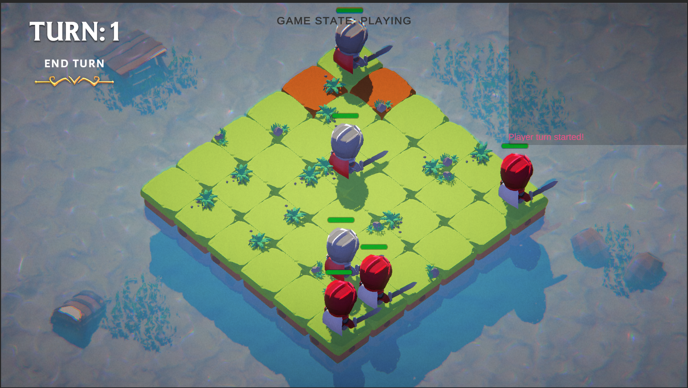

[](https://github.com/starkre22/Atomic/releases)
[](https://github.com/StarKRE22/Atomic.Samples/blob/main/LICENSE.md)


# ⚛️ Atomic Samples

This repository contains **sample projects** for the [Atomic Framework](https://github.com/StarKRE22/Atomic) — an architectural framework for building core gameplay features in **Unity** and **C#**.

Each sample demonstrates a different level of complexity and use case of the framework, from a simple 2-player mini-game to a large-scale RTS simulation with thousands of entities.

> Want to learn more about the framework itself? Visit the [main Atomic repository](https://github.com/StarKRE22/Atomic).

---

# 📑 Table of Contents

- [Sample Projects](#-sample-projects)
    - [Beginner Sample](#1️⃣-beginner-sample)
    - [Top-Down Shooter Sample](#2️⃣-top-down-shooter-sample)
    - [RTS Sample](#3️⃣-rts-sample)
    - [Turn-Based Sample](#4️⃣-turn-based-sample)
- [License](#-license)
- [Contact](#-contact)

---

## 🗂 Sample Projects

All examples are available inside **[Assets/Examples](Assets/Examples)**.

- **[Beginner Sample](Assets/Examples/Beginner)** — a simple 2-player mini-game showcasing the core principles of the
  framework.
- **[Top-Down Shooter Sample](Assets/Examples/Shooter)** — a more advanced, modular game architecture suitable for
  mid-sized projects.
- **[RTS Sample](Assets/Examples/RTS)** — a large-scale simulation demonstrating high-performance entity management with
  thousands of units.
- **[Turn-Based Sample](Assets/Examples/TurnBased)** — a turn-based tactics sample demonstrating event-driven gameplay,
  entity systems, and UI presenters.

---

### 1️⃣ Beginner Sample

A **simple 2-player mini-game** designed to introduce the fundamental ideas behind the Atomic
framework. [Link to the sample](Assets/Examples/Beginner).


This sample represents the **most basic foundation** of the Atomic framework with Unity. It demonstrates how to build
gameplay using a **universal `MonoEntity`**, showing three minimal entities:

- `GameContext`
- `Character`
- `Coin`

Everything here is intentionally kept **as simple and transparent as possible**, focusing on the **core idea of the
atomic approach** — how logic can emerge from the composition of small, modular elements.

The project uses **code generation in Unity** and serves as a minimal example for **rapid prototyping** within the
Atomic ecosystem.

#### 🕹 Gameplay Overview

- **Players:** Two players share a single arena.
- **Goal:** Collect more coins than your opponent within a **limited time**.
- **Controls:**
    - Player (Blue): Arrow keys
    - Player (Red): `W`, `A`, `S`, `D`

#### 💡 This Sample Demonstrates

1. Creating and configuring **Entity** objects in Unity.
2. Structuring a project using the **Entity–State–Behaviour** pattern.
3. Using **atomic elements** to drive logic and interaction.
4. Applying **code generation** for fast and clean iteration.

---

### 2️⃣ Top-Down Shooter Sample

The **Top-Down Shooter** demonstrates a more sophisticated and scalable game architecture, suitable for **mid-size
projects**. [Link to the sample](Assets/Examples/Shooter).


#### 🕹 Gameplay Overview

- **Players:** Two players in a shared arena.
- **Objective:** Eliminate your opponent more times than they eliminate you, within a **time limit**.
- **Controls:**
    - Player (Blue): Arrow keys to move, `Space` to shoot
    - Player (Red): `W`, `A`, `S`, `D` to move, `Q` to shoot
- **Mechanics:**
    - **Movement:** Kinematic character movement with `Rigidbody.SweepTest` collision handling.
    - **Combat:** Independent weapon entities firing physical projectiles.
    - **Projectile:** Kinematic object with trigger collisions and limited lifetime.
    - **Respawn:** Units reappear at random points after death.
    - **Time Limit:** The match ends when the timer expires.
- **Visualization:**
    - Animated characters with sound and VFX.
    - UI displays kills and time remaining.

#### 🧩 Application Structure

- **Scenes:**
    - `Bootstrap` — initializes and loads the game.
    - `Menu` — the main navigation scene.
    - **Levels:** three stages featuring player and enemy spawning.
- **Save System:** Remembers the last completed level.
- **Loading Tree:** Hierarchical scene-loading sequence for structured bootstrapping.

#### 💡 This Sample Demonstrates

1. Designing a complete, **scalable game architecture**.
2. Implementing an **application context** using the Entity–State–Behaviour pattern.
3. Building procedural **menu systems**.
4. Managing complex loading flows with a **Loading Tree**.
5. Saving and restoring **persistent game data**.
6. Turning entities into fully featured **game objects** with animation, VFX, and audio.
7. Managing **projectile pools** efficiently.
8. Structuring a **modular project file system**.

---

### 3️⃣ RTS Sample


The **RTS Sample** showcases **high-performance entity management** — running thousands of active units in real time
with minimal overhead. [Link to the sample](Assets/Examples/RTS).

#### 🕹 Gameplay Overview

- **Armies:** Two large armies automatically engage in battle — each consisting of infantry, tanks, and buildings.
- **Buildings:** Have health points and serve as static defense or production units.
- **Infantry:** Possesses health, performs melee attacks, and seeks the nearest enemy.
- **Tanks:** Fire projectiles and detect enemies within range.
- **Projectiles:** Travel toward targets with limited lifetime and cause impact damage.
- **CameraControls:**
    - Movement: WASD
    - Zoom: Mouse Scroll

#### 🧩 Scenes

- **5000 Units Scene** — 5,000 visualized GameObjects for real-time simulation.
- **10000 Units Scene** — 10,000 entities simulated **without visualization** for performance benchmarking.
- **Entity Baking Scene** — demonstrates converting Unity scene objects into pure C# entities for simulation.

#### 💡 This Sample Demonstrates

1. Running complete **game logic in pure C#**, using Unity solely for visualization.
2. Employing `EntityWorld`, `EntityFactory`, `EntityPool`, `EntityFilter`, and `EntityTriggers`.
3. Using `EntityView`, `EntityViewPool`, and `EntityCollectionView` for rendering and synchronization.
4. Managing **5,000–10,000 active objects** efficiently on a single thread.
5. Baking Unity objects into a **pure data-driven simulation** architecture.

---

### 4️⃣ Turn-Based Sample



The **Turn-Based Sample** demonstrates an event-driven, turn-based tactics game built with Atomic. It covers character
turns, combat, movement, and UI presenters wired to entity state. [Link to the sample](Assets/Examples/TurnBased).

#### 🕹 Gameplay Overview

- **Turn order:** Player and enemy characters take turns one at a time.
- **Actions:** Each character can move within a range and perform a melee or ranged attack.
- **Combat:** Attacks deal damage, push characters back, and trigger death and spawn events.
- **Win/Lose:** The battle ends when all player or all enemy characters are defeated.

#### 🧩 Scenes

- **Game Scene** — the main battle arena with characters, grid, and UI.

#### 💡 This Sample Demonstrates

1. Driving gameplay through an event bus with `[GenerateEventExtensionsAPI]` source-generated extension methods.
2. Separating game logic (use cases), presentation (presenters), and view (UI components).
3. Using entity systems and filters to update characters and resolve turns.
4. Implementing movement, damage, push, spawn, and death mechanics with atomic behaviours.
5. Combining `MonoEntity`, `MonoEntityInstaller`, and `ScriptableEntityBootstrapper` in a Unity scene.

---

## ⚖️ License

This project is licensed under the [MIT License](./LICENSE.md).

```
MIT License

Copyright (c) 2025 Igor Gulkin

Permission is hereby granted, free of charge, to any person obtaining a copy
of this software and associated documentation files (the "Software"), to deal
in the Software without restriction, including without limitation the rights
to use, copy, modify, merge, publish, distribute, sublicense, and/or sell
copies of the Software, and to permit persons to whom the Software is
furnished to do so, subject to the following conditions:

The above copyright notice and this permission notice shall be included in all
copies or substantial portions of the Software.

THE SOFTWARE IS PROVIDED "AS IS", WITHOUT WARRANTY OF ANY KIND, EXPRESS OR
IMPLIED, INCLUDING BUT NOT LIMITED TO THE WARRANTIES OF MERCHANTABILITY,
FITNESS FOR A PARTICULAR PURPOSE AND NONINFRINGEMENT. IN NO EVENT SHALL THE
AUTHORS OR COPYRIGHT HOLDERS BE LIABLE FOR ANY CLAIM, DAMAGES OR OTHER
LIABILITY, WHETHER IN AN ACTION OF CONTRACT, TORT OR OTHERWISE, ARISING FROM,
OUT OF OR IN CONNECTION WITH THE SOFTWARE OR THE USE OR OTHER DEALINGS IN THE
SOFTWARE.
```

---

## 📧 Contact

**Author:** Igor Gulkin  
**Telegram:** [t.me/starkre22](https://t.me/starkre22)  
**Email:** [gulkin.igor.developer@gmail.com](mailto:gulkin.igor.developer@gmail.com)

---

<p align="center">
<a href="#-table-of-contents">Back to top</a> •
<a href="https://github.com/StarKRE22/Atomic">Back to main framework</a> •
<a href="https://github.com/StarKRE22/Atomic.Samples/issues">Report Issue</a> •
<a href="https://github.com/StarKRE22/Atomic.Samples/discussions">Join Discussion</a>
</p>
